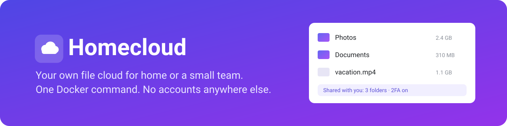
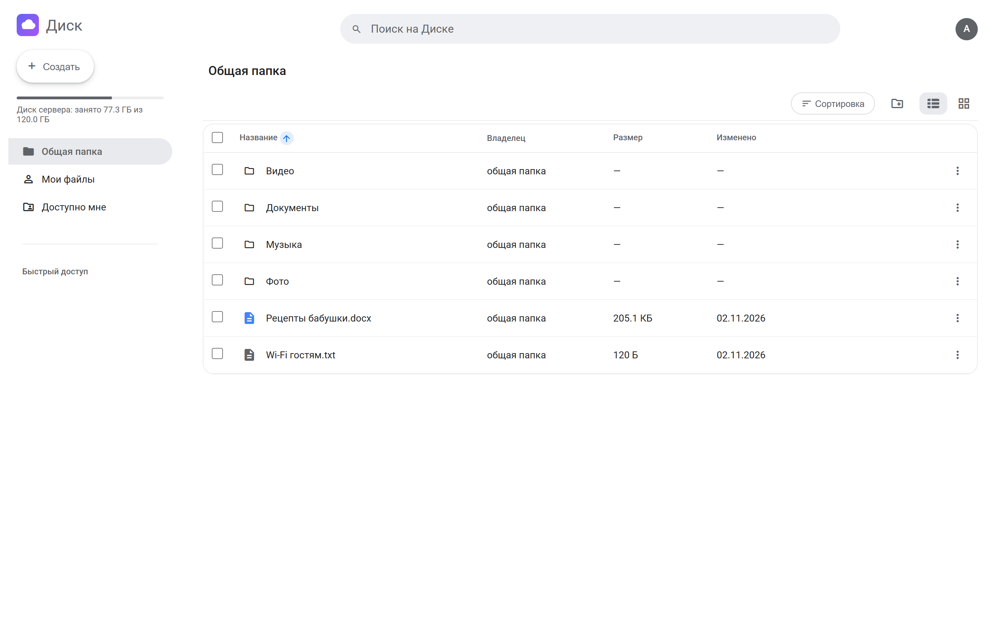
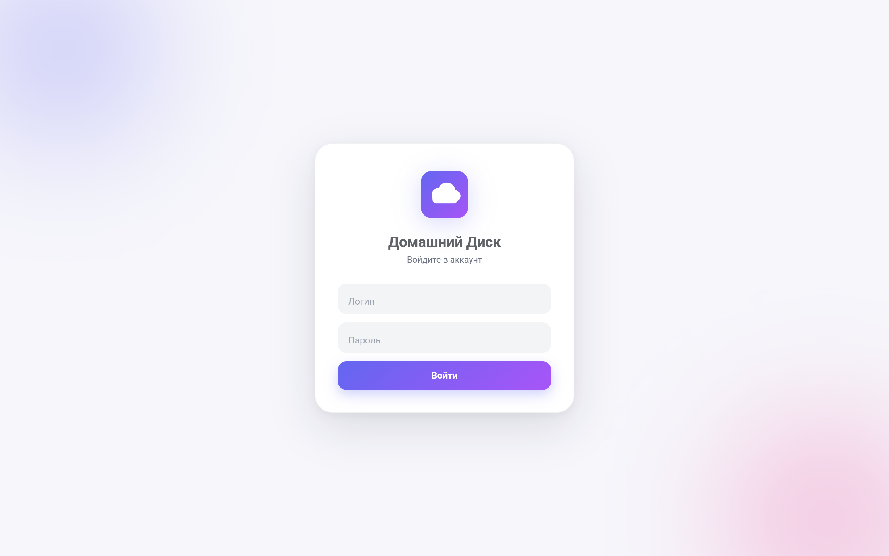
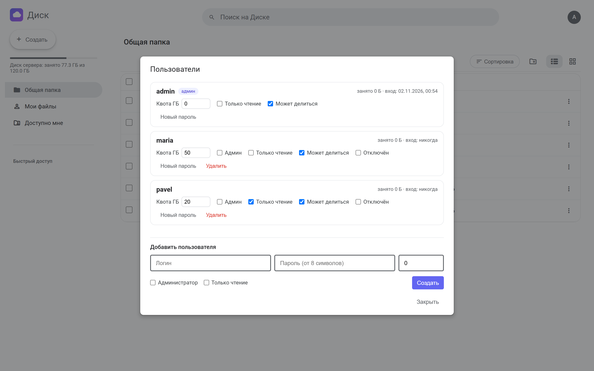
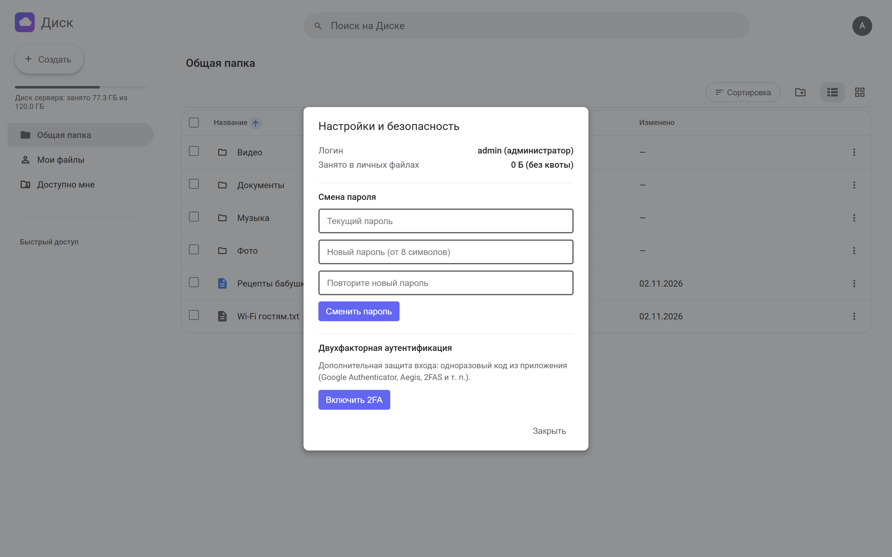
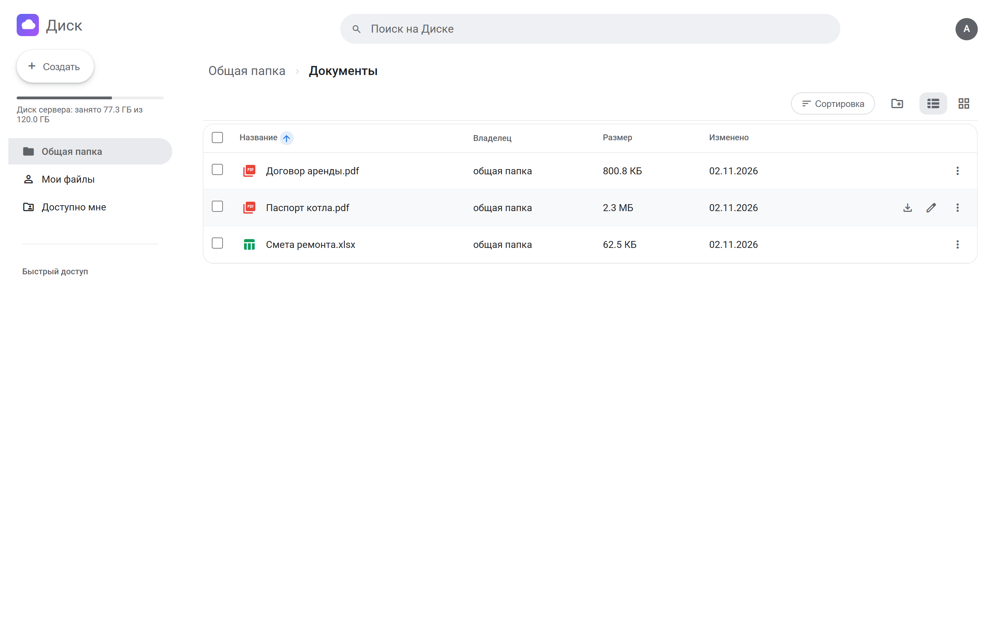
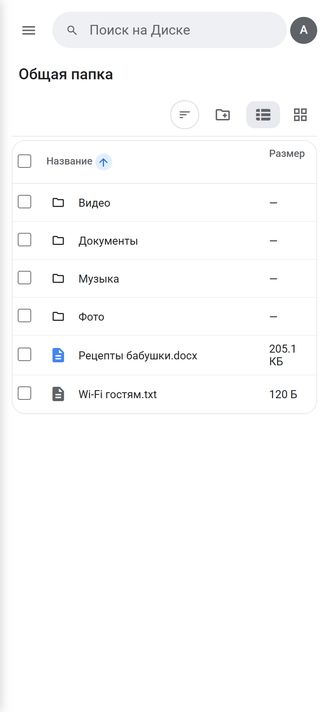

<p align="center">
  
</p>

<p align="center">
  <b>Your own file cloud for home or a small team.</b><br>
  Shared and personal folders, sharing between users, quotas and 2FA. One Docker command, one SQLite file, no third-party services.
</p>

<p align="center">
  
  
  
  
  
  
</p>

<p align="center">
  <a href="#quick-start">Quick start</a> ·
  <a href="#features">Features</a> ·
  <a href="#screenshots">Screenshots</a> ·
  <a href="#backups">Backups</a> ·
  <a href="README.ru.md">Русский</a>
</p>

<p align="center">
  
</p>

## Quick start

```bash
git clone https://github.com/lamine67/home-cloud.git && cd home-cloud
python scripts/init_env.py --http     # creates .env with a random key and admin password, shown once
docker compose up -d --build
```

Open http://localhost:8000 and sign in. The port listens on localhost only: put a reverse proxy with HTTPS in front
(examples in `deploy/`) and run `init_env.py` without `--http` for everyday use.

Without Docker (Python 3.12):

```bash
python -m venv .venv && . .venv/bin/activate     # Windows: .venv\Scripts\activate
pip install -r requirements.txt
python scripts/init_env.py --http
uvicorn app.main:app --host 127.0.0.1 --port 8000
```

A systemd unit for a permanent Linux install is in `deploy/homecloud.service` (instructions at the top of the file).

## Features

- **Shared folder and a personal folder for everyone.** Who may change the shared one is set by `SHARED_WRITE`.
- **Everything you expect from a file manager.** Upload, new folder, rename, copy, move, delete, bulk actions, shortcuts.
- **Zip both ways.** Download a folder or a selection as one zip, unpack archives on the server.
- **Sharing.** Give a file or folder to a specific user, it shows up in their "Shared with me".
- **Users.** The admin creates accounts and sets a quota, read-only mode, sharing rights, disables or deletes them.
- **Security.** bcrypt passwords, TOTP 2FA (Google Authenticator, Aegis, 2FAS), login rate limit, signed cookies, no way out
  of your own folder.
- **Works offline from the internet.** Fonts and scripts are bundled in `static/`, no CDNs. Installs on a phone as an app.
- **Optional media conversion** in personal folders with `ffmpeg` (build the image with `--build-arg WITH_FFMPEG=true`).

## Screenshots

<table>
  <tr>
    <td width="50%"></td>
    <td width="50%"></td>
  </tr>
  <tr>
    <td></td>
    <td></td>
  </tr>
</table>

<p align="center"></p>

## Configuration

Everything lives in `.env`, see [.env.example](.env.example) for the full list. The main ones:

| Variable | Meaning |
|---|---|
| `SECRET_KEY` | cookie signing key, at least 32 characters |
| `ADMIN_USER`, `ADMIN_PASSWORD` | first admin, created only while the database has no users |
| `DATA_DIR`, `STORAGE_DIR`, `PERSONAL_DIR` | where the database, the shared folder and personal folders live |
| `SHARED_WRITE` | who may change the shared folder: `admin`, `users` or `none` |
| `COOKIE_SECURE`, `TRUST_PROXY` | HTTPS and running behind a reverse proxy |
| `LOGIN_MAX_ATTEMPTS`, `LOGIN_WINDOW_SEC` | brute-force protection |

## Locked out?

```bash
python -m app.cli list-users
python -m app.cli create-user NAME --admin
python -m app.cli set-password NAME
python -m app.cli reset-2fa NAME
```

## Backups

Copy the data directory (`DATA_DIR`, the `homecloud-data` volume in Docker). It holds `app.db` and all files.

```bash
docker run --rm -v homecloud-data:/data -v "$PWD":/backup alpine tar czf /backup/homecloud-backup.tgz -C /data .
```

## Development

```bash
pip install -r requirements-dev.txt
pytest -q
```

```text
app/        FastAPI: sign-in and 2FA (auth.py), files and sharing (files.py), database (db.py), settings (config.py), cli.py
static/     UI: pages, scripts, styles, fonts, icons, manifest.json
deploy/     nginx, Caddy and systemd examples
scripts/    init_env.py creates .env
tests/      API tests
```

The interface is in Russian for now.

## License

[MIT](LICENSE)
