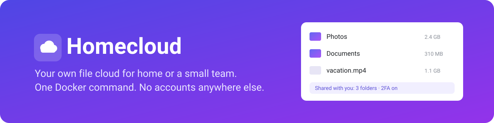
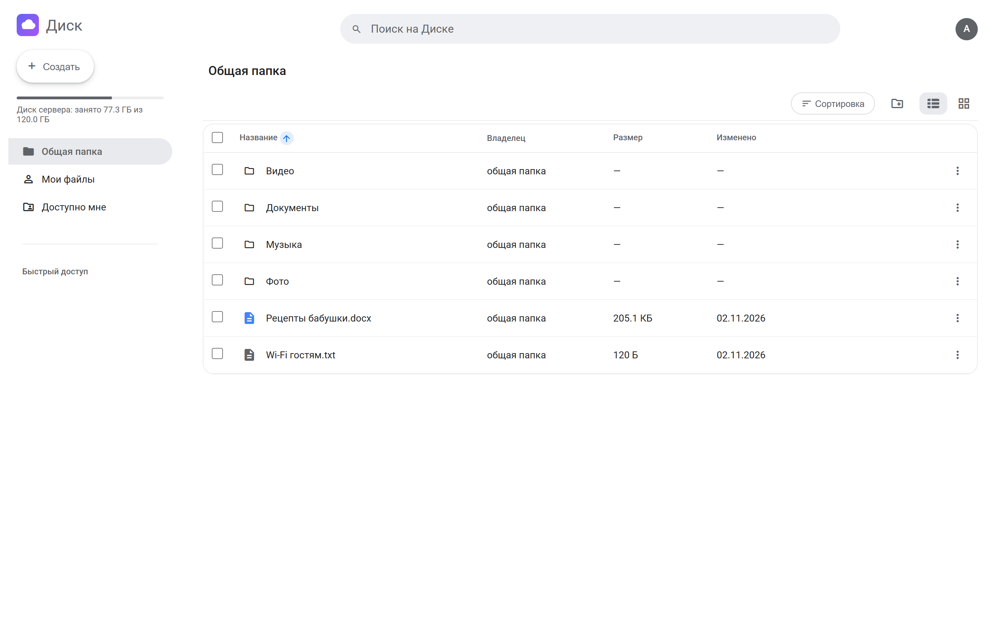
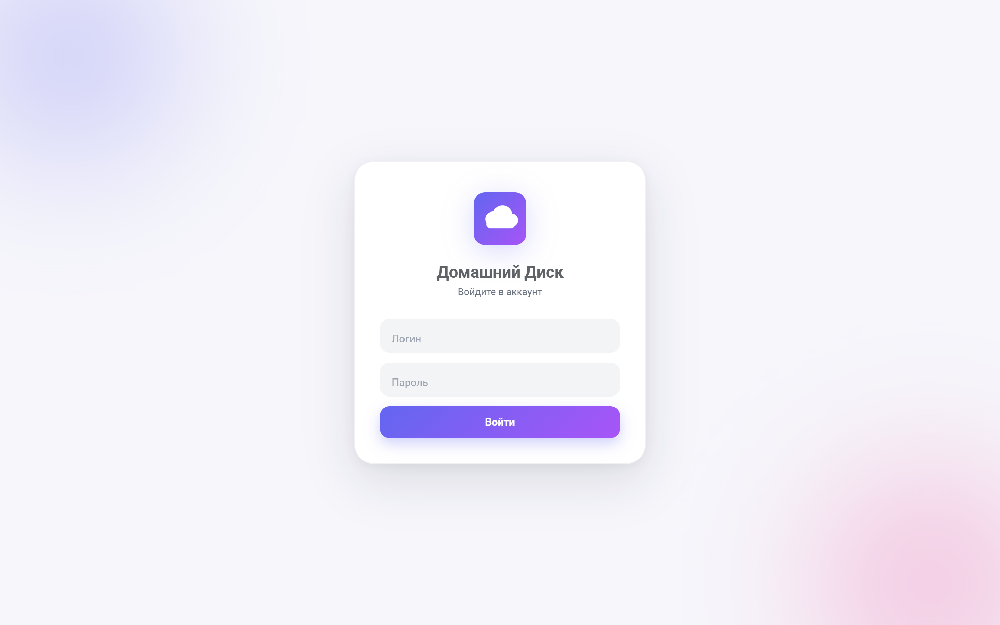
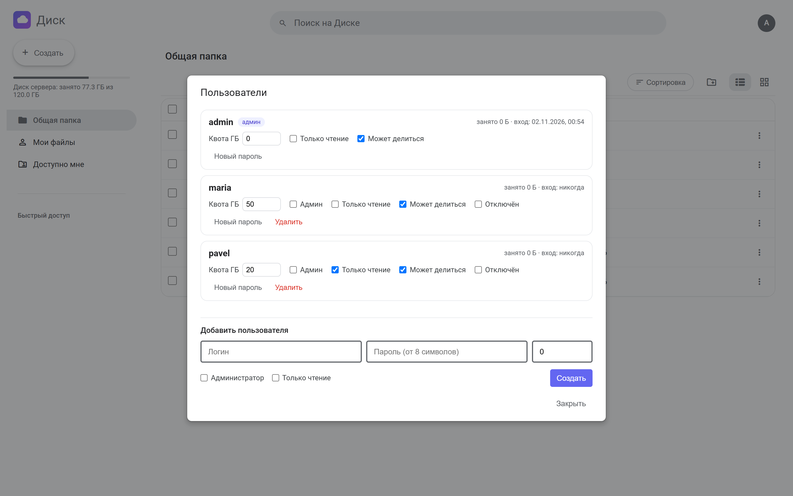
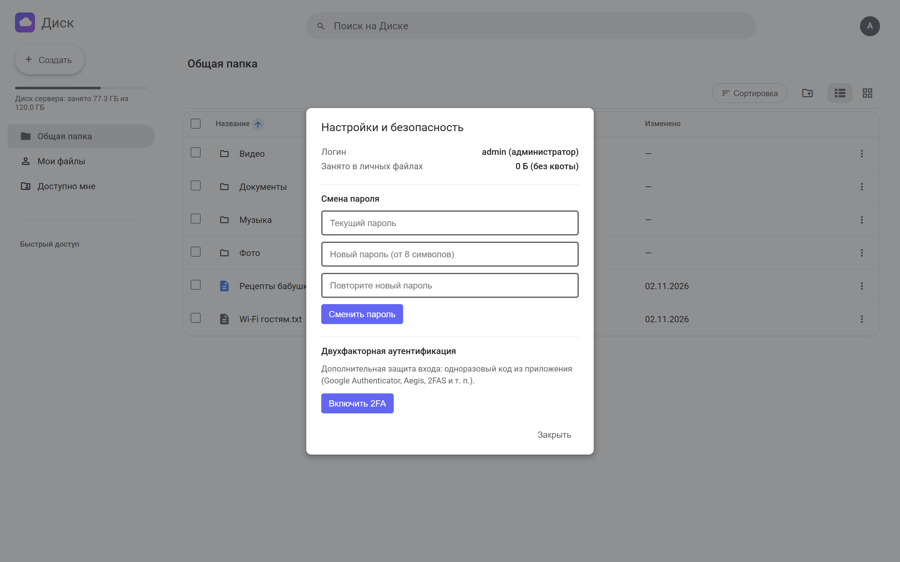
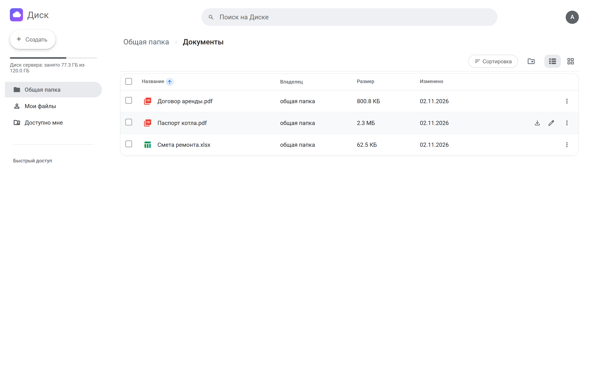
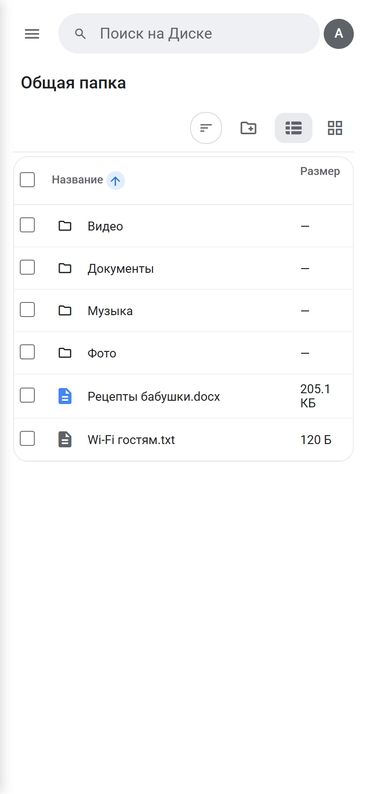

<p align="center">
  
</p>

<p align="center">
  <b>Своё облако для файлов дома или в маленькой команде («Домашний Диск»).</b><br>
  Общие и личные папки, обмен между пользователями, квоты и 2FA. Одна команда Docker, один файл SQLite, никаких сторонних сервисов.
</p>

<p align="center">
  
  
  
  
  
  
</p>

<p align="center">
  <a href="#быстрый-старт">Быстрый старт</a> ·
  <a href="#возможности">Возможности</a> ·
  <a href="#скриншоты">Скриншоты</a> ·
  <a href="#резервная-копия">Резервная копия</a> ·
  <a href="README.md">English</a>
</p>

<p align="center">
  
</p>

## Быстрый старт

```bash
git clone https://github.com/lamine67/home-cloud.git && cd home-cloud
python scripts/init_env.py --http     # создаст .env со случайным ключом и паролем администратора, покажет их один раз
docker compose up -d --build
```

Откройте http://localhost:8000 и войдите. Порт слушается только на локальном интерфейсе: для постоянной работы поставьте
обратный прокси с HTTPS (примеры в `deploy/`) и запускайте `init_env.py` без `--http`.

Без Docker (Python 3.12):

```bash
python -m venv .venv && . .venv/bin/activate     # Windows: .venv\Scripts\activate
pip install -r requirements.txt
python scripts/init_env.py --http
uvicorn app.main:app --host 127.0.0.1 --port 8000
```

Для постоянной работы на Linux есть юнит systemd: `deploy/homecloud.service` (как установить, написано в начале файла).

## Возможности

- **Общая папка и личная папка у каждого.** Кто может менять общую, задаётся в `SHARED_WRITE`.
- **Всё, что ждёшь от файлового менеджера.** Загрузка, новые папки, переименование, копирование, перенос, удаление,
  массовые действия, ярлыки.
- **Zip в обе стороны.** Скачать папку или выбранное одним архивом, распаковать архив на сервере.
- **Обмен.** Файл или папку можно открыть конкретному пользователю, у него это появится в «Доступно мне».
- **Пользователи.** Администратор создаёт аккаунты, задаёт квоту, режим «только чтение», право делиться, отключает и удаляет.
- **Безопасность.** Пароли в bcrypt, 2FA по TOTP (Google Authenticator, Aegis, 2FAS), ограничение попыток входа,
  подписанные cookie, выйти за пределы своей папки нельзя.
- **Работает без интернета.** Шрифты и скрипты лежат в `static/`, без CDN. Ставится на телефон как приложение.
- **Конвертация аудио и видео** в личных папках через `ffmpeg`, по желанию (образ собирается с `--build-arg WITH_FFMPEG=true`).

## Скриншоты

<table>
  <tr>
    <td width="50%"></td>
    <td width="50%"></td>
  </tr>
  <tr>
    <td></td>
    <td></td>
  </tr>
</table>

<p align="center"></p>

## Настройки

Всё задаётся в `.env`, полный список в [.env.example](.env.example). Основное:

| Параметр | Что делает |
|---|---|
| `SECRET_KEY` | ключ подписи cookie, не короче 32 символов |
| `ADMIN_USER`, `ADMIN_PASSWORD` | первый администратор, создаётся только пока в базе нет пользователей |
| `DATA_DIR`, `STORAGE_DIR`, `PERSONAL_DIR` | где лежат база, общая папка и личные папки |
| `SHARED_WRITE` | кто меняет общую папку: `admin`, `users` или `none` |
| `COOKIE_SECURE`, `TRUST_PROXY` | HTTPS и работа за обратным прокси |
| `LOGIN_MAX_ATTEMPTS`, `LOGIN_WINDOW_SEC` | защита от подбора пароля |

## Если не получается войти

```bash
python -m app.cli list-users
python -m app.cli create-user NAME --admin
python -m app.cli set-password NAME
python -m app.cli reset-2fa NAME
```

## Резервная копия

Копируйте каталог данных (`DATA_DIR`, в Docker это том `homecloud-data`): там база `app.db` и все файлы.

```bash
docker run --rm -v homecloud-data:/data -v "$PWD":/backup alpine tar czf /backup/homecloud-backup.tgz -C /data .
```

## Разработка

```bash
pip install -r requirements-dev.txt
pytest -q
```

```text
app/        FastAPI: вход и 2FA (auth.py), файлы и обмен (files.py), база (db.py), настройки (config.py), cli.py
static/     интерфейс: страницы, скрипты, стили, шрифты, иконки, manifest.json
deploy/     примеры для nginx, Caddy и systemd
scripts/    init_env.py создаёт .env
tests/      тесты API
```

## Лицензия

[MIT](LICENSE)
